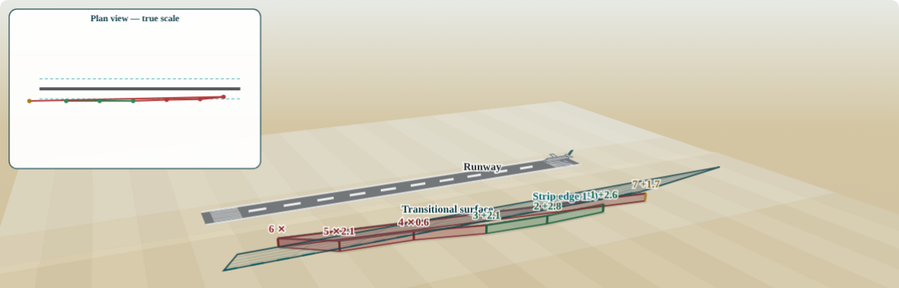

# OLS Fence Simulator — محاكي أسطح تحديد العوائق

**Live demo: <https://ols-fence-simulator.netlify.app>** · mirror: <https://moo7999.github.io/ols-fence-simulator/>

**جربه مباشرة من المتصفح — بدون تحميل ولا تسجيل**

An open-source, single-file, bilingual (Arabic/English) educational tool that lets any airport team instantly check whether a fence or object near a runway complies with the obstacle limitation surfaces (OLS) — the runway strip limit and the transitional surface — per the geometry of ICAO Annex 14 Vol I (Table 4-1).

أداة تعليمية مفتوحة المصدر بملف واحد وواجهة ثنائية اللغة، تمكّن أي فريق مطار من الفحص الفوري لمطابقة سور أو جسم بجوار المدرج لأسطح تحديد العوائق — حد شريط المدرج والسطح الانتقالي — وفق هندسة الملحق 14 لمنظمة الطيران المدني الدولي

## Features — المزايا

- Realistic interactive 3D scene: desert terrain to the horizon, marked runway, mesh fence, translucent transitional surface — مشهد ثلاثي الأبعاد واقعي تفاعلي
- Walk mode: stand mid-runway or on either threshold at eye level, look around and walk (home button cycles the viewpoints) — وضع الوقوف داخل الموقع: وسط المدرج أو على العتبتين بارتفاع عين الإنسان
- On-screen orbit/tilt/zoom buttons that work on any device, plus drag and wheel — أزرار تحكم على الشاشة تعمل في أي جهاز
- 2D cross-section view with the full calculation breakdown — مقطع عرضي مع تفاصيل الحساب
- Free inputs for any airport: centreline elevation, ground elevation, strip half-width, transitional slope — مدخلات حرة لأي مطار
- Instant verdict with penetration/margin and the minimum compliant distance — حكم فوري مع مقدار الاختراق أو الهامش والحد الأدنى للمسافة
- Full lateral OLS profile: transitional, inner horizontal (45 m default) and conical (5%) surfaces — المقطع الجانبي كامل: السطح الانتقالي والأفقي الداخلي والمخروطي
- Object types: mesh fence or tower crane, plus a parked aircraft on the runway for scale — نوع الجسم: سور شبكي أو رافعة برجية، مع طائرة على المدرج لإحساس الحجم
- Saudi airports quick-fill: pick an airport (27 civil airports built in) and its runway — both thresholds fill automatically, converted to UTM on the fly; advisory data, the current AIP always governs — تعبئة تلقائية لعتبات مدارج المطارات السعودية مع التحويل المتري الفوري، والعبرة دائماً بالنشرة الرسمية
- Batch check: define the centreline by its two thresholds, then paste a point table straight from Excel or attach a CSV, .xlsx or .docx file (read natively, no libraries) — per-point verdicts with distance, station, governing surface and margin, the whole fence drawn in the 3D scene coloured by verdict plus a true-scale plan inset of its real shape, with the aircraft taking off and landing when every point clears, click any row to highlight it, export results as CSV — فحص جماعي: عرّف المحور بالعتبتين وألصق جدول النقاط من الإكسل أو أرفق ملفاً، وحكم لكل نقطة مع تصدير النتائج
- Works fully offline, no libraries, no network — one HTML file — يعمل بلا إنترنت وبلا مكتبات، ملف واحد
- Light/dark aware, phone friendly — يدعم الوضع الليلي والجوال

## Screenshots — لقطات

| Aerial — penetration | Aerial — compliant | Standing on the threshold |
|---|---|---|
|  |  |  |

Batch check — the whole point table drawn in the scene, coloured by verdict:

## Usage — الاستخدام

Use it live at the link above, or open `index.html` in any browser — it works fully offline. Host it anywhere (GitHub Pages / Netlify work out of the box).

افتح الملف بأي متصفح، أو استضفه على أي خدمة صفحات ثابتة

## Roadmap — خارطة الطريق

Current version covers the two criteria that govern lateral objects near the runway: the runway strip limit and the transitional surface. Planned next, community contributions welcome:

- Approach and take-off climb surfaces (runway ends)
- Shareable links that encode a full case in the URL

النسخة الحالية تغطي المعيارين الحاكمين للأجسام الجانبية: حد شريط المدرج والسطح الانتقالي، والمخطط لاحقاً بمشاركة المجتمع: سطحا الاقتراب والإقلاع عند نهايتي المدرج، وروابط مشاركة تحفظ الحالة كاملة

## The rule — القاعدة

distance from centreline ≥ strip half-width + slope factor × (object top elevation − centreline elevation)

المسافة عن خط المنتصف ≥ نصف عرض الشريط + معامل الميل × (منسوب قمة الجسم − منسوب خط المنتصف)

## Disclaimer — إخلاء مسؤولية

Educational advisory tool only. Not a substitute for a formal aeronautical study, certified survey, or approval by the competent civil aviation authority. The declared strip and surfaces published in each State AIP always govern.

أداة تعليمية استرشادية فقط، لا تغني عن الدراسة الرسمية والرفع المساحي المعتمد وموافقة سلطة الطيران المدني المختصة، والعبرة دائماً بالشريط والأسطح المعلنة في نشرة معلومات الطيران لكل دولة

## License

MIT — see `LICENSE`.

Concept & development: MUATH A. QUSAIER
