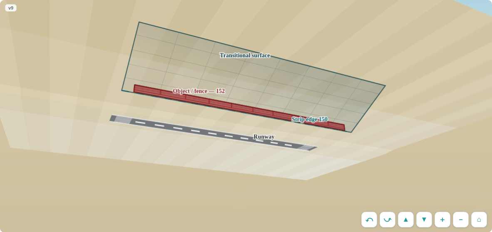
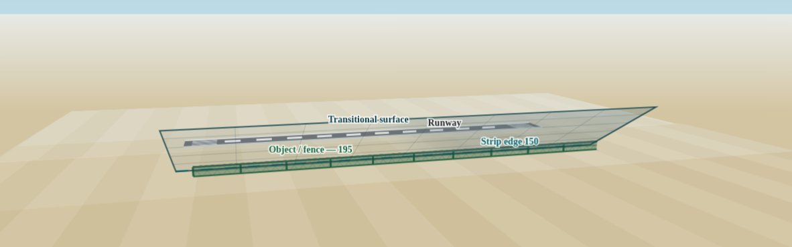
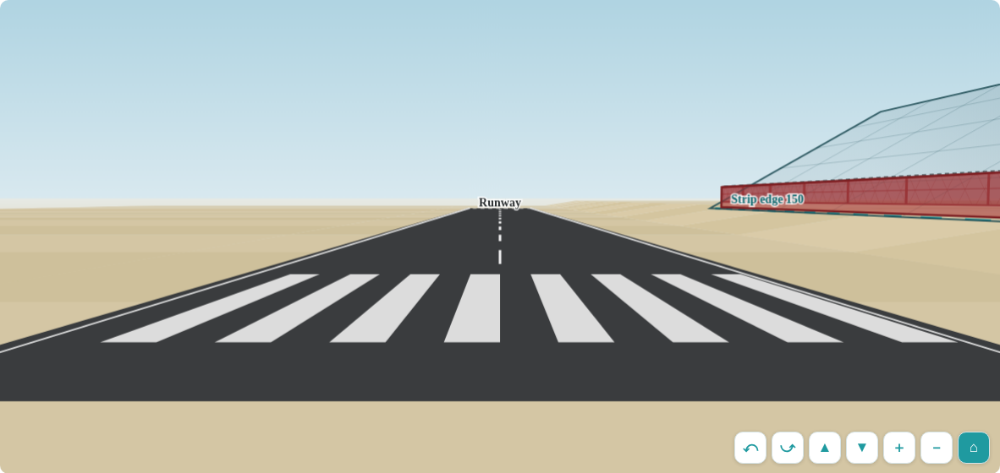

# OLS Fence Simulator — محاكي أسطح تحديد العوائق

An open-source, single-file, bilingual (Arabic/English) educational tool that lets any airport team instantly check whether a fence or object near a runway complies with the obstacle limitation surfaces (OLS) — the runway strip limit and the transitional surface — per the geometry of ICAO Annex 14 Vol I (Table 4-1).

أداة تعليمية مفتوحة المصدر بملف واحد وواجهة ثنائية اللغة، تمكّن أي فريق مطار من الفحص الفوري لمطابقة سور أو جسم بجوار المدرج لأسطح تحديد العوائق — حد شريط المدرج والسطح الانتقالي — وفق هندسة الملحق 14 لمنظمة الطيران المدني الدولي

## Features — المزايا

- Realistic interactive 3D scene: desert terrain to the horizon, marked runway, mesh fence, translucent transitional surface — مشهد ثلاثي الأبعاد واقعي تفاعلي
- Walk mode: stand mid-runway or on either threshold at eye level, look around and walk (home button cycles the viewpoints) — وضع الوقوف داخل الموقع: وسط المدرج أو على العتبتين بارتفاع عين الإنسان
- On-screen orbit/tilt/zoom buttons that work on any device, plus drag and wheel — أزرار تحكم على الشاشة تعمل في أي جهاز
- 2D cross-section view with the full calculation breakdown — مقطع عرضي مع تفاصيل الحساب
- Free inputs for any airport: centreline elevation, ground elevation, strip half-width, transitional slope — مدخلات حرة لأي مطار
- Instant verdict with penetration/margin and the minimum compliant distance — حكم فوري مع مقدار الاختراق أو الهامش والحد الأدنى للمسافة
- Works fully offline, no libraries, no network — one HTML file — يعمل بلا إنترنت وبلا مكتبات، ملف واحد
- Light/dark aware, phone friendly — يدعم الوضع الليلي والجوال

## Screenshots — لقطات

| Aerial — penetration | Aerial — compliant | Standing on the threshold |
|---|---|---|
|  |  |  |

## Usage — الاستخدام

Open `index.html` in any browser. Or host it anywhere (GitHub Pages works out of the box).

افتح الملف بأي متصفح، أو استضفه على أي خدمة صفحات ثابتة

## The rule — القاعدة

distance from centreline ≥ strip half-width + slope factor × (object top elevation − centreline elevation)

المسافة عن خط المنتصف ≥ نصف عرض الشريط + معامل الميل × (منسوب قمة الجسم − منسوب خط المنتصف)

## Disclaimer — إخلاء مسؤولية

Educational advisory tool only. Not a substitute for a formal aeronautical study, certified survey, or approval by the competent civil aviation authority. The declared strip and surfaces published in each State AIP always govern.

أداة تعليمية استرشادية فقط، لا تغني عن الدراسة الرسمية والرفع المساحي المعتمد وموافقة سلطة الطيران المدني المختصة، والعبرة دائماً بالشريط والأسطح المعلنة في نشرة معلومات الطيران لكل دولة

## License

MIT — see `LICENSE`.

Concept & development: Muath A. Al-Qaseer
